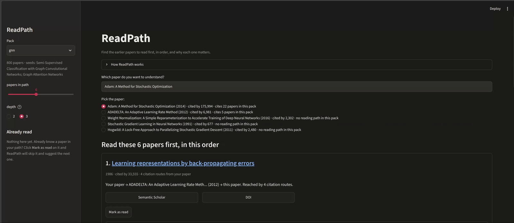
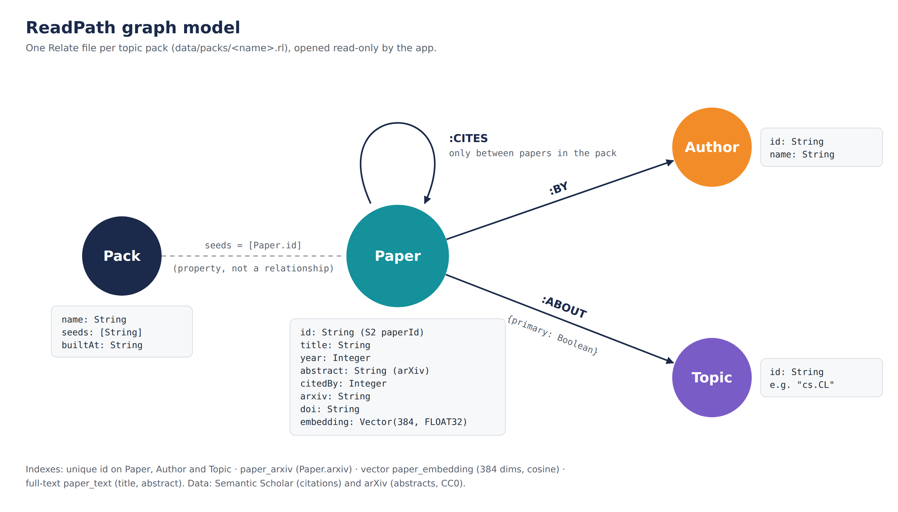

# ReadPath

**Give it any research paper and get the 5–7 earlier papers to read first, in order, with the citation chain that explains why each one matters.**

Demo video: _link coming soon_



Built on [Relate](https://relatedb.ai), the embedded graph database, for the Relate by Neo4j Hackathon.

## 1. The problem

When you open an important paper outside your own field, it assumes you already know the papers it builds on, and its reference list gives you 40 titles with no order and no reasons. Students, engineers and researchers waste hours reading the wrong background papers first, or give up. ReadPath answers one question: *which few earlier papers should I read before this one, in what order, and why each one?*

## 2. What connects to what

Each topic pack is a small graph of papers and the papers they cite:

| Node | Main properties | Relationship |
|---|---|---|
| `Paper` | `id` (Semantic Scholar paperId), `title`, `year`, `abstract` (arXiv), `citedBy`, `arxiv`, `doi`, `embedding` (384-number vector) | `(:Paper)-[:CITES]->(:Paper)`, only between papers in the pack |
| `Author` | `id`, `name` | `(:Paper)-[:BY]->(:Author)` |
| `Topic` | `id`, an arXiv category such as `cs.CL` | `(:Paper)-[:ABOUT {primary: true/false}]->(:Topic)` |
| `Pack` | `name`, `seeds` (paperIds), `builtAt` | none (it describes the pack) |



(The same model as an [arrows.app](https://arrows.app) import file: [docs/graph-model.arrows.json](docs/graph-model.arrows.json).)

## 3. How Relate is used, and why

| What | Why | Where |
|---|---|---|
| **Embedded Python client** (`relate-db`): no server to install or run | The app, the CLI and the tests just open a file | [readpath/store.py](readpath/store.py) (`open_store`), [app.py](app.py) |
| **Schema**: unique ids, a range index on `arxiv`, a 384-dimension cosine **vector index**, a **full-text index** on title + abstract | Fast lookups and both kinds of search on one store | `SCHEMA_STATEMENTS` in [readpath/queries.py](readpath/queries.py) |
| **One write transaction** with `UNWIND` batches of 200 and typed vectors `vector($emb, 384, FLOAT32)` | A pack is written all at once, or not at all | `write_pack` in [readpath/store.py](readpath/store.py), [build_pack.py](build_pack.py) |
| **Vector + full-text `SEARCH`**, fused in Python with **reciprocal rank fusion** | Meaning-based and exact-word matches each miss things the other finds | `VECTOR_SEARCH`, `FULLTEXT_SEARCH` in [readpath/queries.py](readpath/queries.py); `rrf_fuse` in [readpath/search.py](readpath/search.py) |
| **Bounded `CITES` path queries** (`[:CITES*1..2]` and `[:CITES*1..3]`, one constant per depth) that count citation routes and return the shortest chains | The "why" for every paper comes straight from graph paths | `FOUNDATIONS_D2/D3`, `WHY_CHAINS_D2/D3`, `LOOP_WALKS_D3` in [readpath/queries.py](readpath/queries.py); [readpath/path.py](readpath/path.py) |
| **MCP server for agents**: `relate serve --mcp stdio --read-only` | Claude Code (or any MCP client) can query a pack safely | [.mcp.json](.mcp.json), [.claude/skills/reading-path/SKILL.md](.claude/skills/reading-path/SKILL.md) |
| **CLI**: `relate clone` compacts each new pack; `relate --read-only` checks it | One small, clean file per pack, verified from the shell | `write_store` in [build_pack.py](build_pack.py); [section 8](#8-three-example-relate-cli-queries) |

Relate has no APOC or GDS, so the reading order (a topological sort with a year tie-break) runs in Python with networkx: [readpath/order.py](readpath/order.py). All Cypher lives in one file, [readpath/queries.py](readpath/queries.py), and every value is passed as a `$parameter`.

## 4. Store mode: one `.rl` file per topic pack

Each pack is **one single `.rl` file**:

- **One file to copy and share.** A pack can be committed to git, e-mailed or dropped into another project, with no database server and no import step.
- **Read-only at runtime.** The app, the CLI and the MCP server open packs with `read_only=True` / `--read-only`, so nothing can change a pack while people use it. Your "already read" list is kept outside the pack, in `data/my_reading.json` (git-ignored), so packs stay shareable.
- **Rebuilt safely.** `build_pack.py` writes to a temporary store, compacts it with `relate clone`, and only then replaces `<name>.rl`.

## 5. Where the data is

Both packs are committed, so judges need no API key and no download:

| File | Seeds | Papers | `CITES` | Authors (`BY`) | Topics (`ABOUT`) | Papers with an arXiv abstract | Size |
|---|---|---:|---:|---:|---:|---:|---:|
| [data/packs/transformers.rl](data/packs/transformers.rl) | Attention Is All You Need | 694 | 4,204 | 1,291 (2,384) | 19 (612) | 303 (44%) | 4.9 MB |
| [data/packs/gnn.rl](data/packs/gnn.rl) | Semi-Supervised Classification with Graph Convolutional Networks; Graph Attention Networks | 800 | 3,344 | 1,862 (2,858) | 39 (631) | 290 (36%) | 5.7 MB |

Papers without an arXiv id (often older classics such as LSTM, 1997) have no abstract; ReadPath embeds their title instead.

## 6. Quick start on Ubuntu

Copy and paste:

```bash
# 1. System packages
sudo apt update && sudo apt install -y git make curl python3-venv

# 2. The relate CLI (used by the MCP server and the example queries)
curl -sSfL https://relatedb.ai/install.sh | bash
export PATH="$HOME/.local/bin:$PATH"   # only needed until your next login
relate --version

# 3. Get ReadPath and install it (CPU-only PyTorch, no GPU needed)
git clone https://github.com/SalemBenafia/readpath.git
cd readpath
make setup

# 4. Start the app
make run
```

**What you should see:**

- `relate --version` prints `Relate v1.3.0`.
- `make setup` ends with `Successfully installed ...` (or "Requirement already satisfied" lines).
- `make run` prints `Local URL: http://localhost:8501`. Open that address in your browser.
- The first start downloads the small embedding model (about 90 MB, once), so it takes a little longer. Without internet, search still works using full-text only.
- In the browser, the sidebar shows the pack (**gnn** is selected first; switch to **transformers**), its paper count and seeds, a "papers in path" slider and a "depth" choice.
- Type `Attention Is All You Need` (in the transformers pack) and pick the first option. You get 6 numbered cards, from *Long Short-Term Memory (1997)* to *Neural Machine Translation by Jointly Learning to Align and Translate (2014)*, each with one sentence on **why**, then the citation graph. In "Show why for…", choose a paper to highlight its citation chains.
- Shortcut: http://localhost:8501/?paper=204e3073870fae3d05bcbc2f6a8e263d9b72e776 opens that reading path directly.

Press `Ctrl+C` in the terminal to stop the app. The same reading path from the terminal:

```bash
.venv/bin/python -m readpath path "Attention Is All You Need" --pack transformers
```

## 7. Use it from Claude Code

The repo's [.mcp.json](.mcp.json) registers a **project MCP server** called `readpath`. It runs `relate serve --mcp stdio --database ./data/packs/transformers.rl --read-only`, so it can read the pack but never change it.

1. Make sure `relate` is on your PATH (step 2 above), then start `claude` in the `readpath` folder.
2. Claude Code asks whether to use the new project server from `.mcp.json`: approve **readpath**.
3. Type `/mcp`. `readpath` should show as connected, with two tools: `get_schema` and `read_cypher`.
4. Ask for a reading path with the project skill:

   ```
   /reading-path Attention Is All You Need
   ```

   The skill ([.claude/skills/reading-path/SKILL.md](.claude/skills/reading-path/SKILL.md)) finds the paper with full-text search, gets its foundations and shortest citation chains through `read_cypher`, and answers with a numbered reading list. It never invents papers that are not in the graph.

To point the server at the GNN pack, change `transformers.rl` to `gnn.rl` in `.mcp.json`.

## 8. Three example relate CLI queries

Run these from the `readpath` folder. Values go in with `--param` (put quotes inside, as in `'arxiv="1706.03762"'`, to keep an id as text).

**The papers most cited inside the transformers pack:**

```bash
relate --database data/packs/transformers.rl --read-only --mode table \
  'MATCH (p:Paper)<-[:CITES]-(c:Paper) RETURN p.title AS paper, p.year AS year, count(c) AS cited_in_pack ORDER BY cited_in_pack DESC LIMIT 5'
```

Top answer: *Long Short-Term Memory* (1997), cited by 116 papers in the pack.

**Full-text search in the GNN pack:**

```bash
relate --database data/packs/gnn.rl --read-only --mode table --param 'q="graph attention"' \
  'MATCH (p:Paper) SEARCH p IN (FULLTEXT INDEX paper_text FOR $q LIMIT 5) SCORE AS score RETURN p.title AS title, p.year AS year, round(score, 2) AS score'
```

Top answer: *Graph Attention Networks* (2017).

**Foundations of "Attention Is All You Need" within 2 citation hops, ranked by number of routes:**

```bash
relate --database data/packs/transformers.rl --read-only --mode table --param 'arxiv="1706.03762"' \
  'MATCH (t:Paper {arxiv: $arxiv})-[:CITES*1..2]->(f:Paper) WHERE f <> t WITH f, count(*) AS routes RETURN f.title AS foundation, f.year AS year, routes ORDER BY routes DESC LIMIT 5'
```

Top answer: *Long Short-Term Memory* (1997) with 23 routes, then Bahdanau et al. (2014) with 20.

## 9. Build your own pack

Free, and no account is needed:

```bash
.venv/bin/python build_pack.py --name gnn \
  --seed "Semi-Supervised Classification with Graph Convolutional Networks" \
  --seed "Graph Attention Networks" --max-papers 800
```

- It matches each seed title on the Semantic Scholar Graph API, takes the papers they cite (level 1) and the papers those cite most (level 2), and keeps citations only inside the pack.
- Abstracts and categories come from the arXiv API (at most one request every 3 seconds).
- Every API response is cached in `data/raw/`, so a stopped or rate-limited build continues where it stopped when you run it again.
- Add `--dry-run` to see a summary (papers per level, edges, top cited) without writing a pack.
- Optional: a free Semantic Scholar API key gives a higher rate limit. Put `S2_API_KEY=...` in a `.env` file. Without a key, ReadPath waits and retries when the shared free limit is busy.
- Building needs the `relate` CLI (for `relate clone`). Stop the app before you rebuild a pack it is using.

## 10. Tests

```bash
make test
```

The tests need no network, no API key and no model download. They build tiny packs in temporary `.rl` files, including one where the right reading path is obvious, and they drive the Streamlit app end to end with Streamlit's `AppTest`.

## 11. Tools used

**Relate features:**
- the embedded Python client `relate-db`
- single-file `.rl` stores and read-only opens
- explicit transactions and `UNWIND` batch writes
- unique constraints, range index, vector index with typed `vector(…, 384, FLOAT32)` values, full-text index
- the `SEARCH … SCORE AS` clause
- bounded variable-length paths with `nodes(path)` list comprehensions
- `relate clone`, `relate serve --mcp stdio --read-only`, and the `relate` CLI with `--read-only`, `--mode table` and `--param`
- the Relate agent skill for Claude Code (`relate skill install --agent claude-code`)

**Third-party tools:**
- Python
- [sentence-transformers](https://www.sbert.net/) with the `all-MiniLM-L6-v2` model, on CPU-only [PyTorch](https://pytorch.org/)
- [networkx](https://networkx.org/) (reading order)
- [Streamlit](https://streamlit.io/) and [streamlit-agraph](https://github.com/ChrisDelClea/streamlit-agraph) (app and graph view)
- requests, python-dotenv, pytest

**Data:**
- [Semantic Scholar Academic Graph API](https://www.semanticscholar.org/product/api): papers, authors, years, citations
- [arXiv API](https://info.arxiv.org/help/api/index.html): abstracts, categories

**AI tools:** [Claude Code](https://claude.com/claude-code) (model: Claude Opus 5.5).

**How Claude Code was used (honest summary of [docs/AI_USAGE.md](docs/AI_USAGE.md)):**
- **How the work was split.** ReadPath was built in about 15 small steps. For each step I wrote the request: what to build, the rules in [CLAUDE.md](CLAUDE.md), and for the core path queries the Cypher itself. Claude Code proposed a plan, and I approved it. Claude Code then wrote the code and tests, ran `make test` and the real commands, and committed. Nearly all code in this repository was written by Claude Code. I decided the scope, the data rules, the graph model and the UI, and I checked the results of every step.
- **Problems found by running things, not by guessing:**
  - Hybrid search ranked "Attention is All you Need" only 8th for its own title, so an exact title match now comes first.
  - 43 mutual-citation pairs inflated route counts, so routes that visit a paper twice are no longer counted.
  - A review against CLAUDE.md found a pack rebuild that could delete the committed pack, and missing credits; both were fixed.
- **Mistakes Claude Code made and fixed itself:** a few tests had wrong expected values, and one bulk edit broke a test file before it was committed.
- **Limits:**
  - Claude Code could not use a real browser in this setup, so the app was tested with Streamlit's `AppTest` and timed on the server side.
  - The screenshot in this README was taken by hand.
  - [docs/graph-model.png](docs/graph-model.png) was drawn by Claude Code as an SVG, not in arrows.app. The arrows.app import file is provided.

## 12. Data credits and licences

- **Citation data:** [Semantic Scholar](https://www.semanticscholar.org/), Semantic Scholar Academic Graph API (Allen Institute for AI). The credit is required by the Semantic Scholar API licence, and it is also shown in the app footer.
- **Abstracts and categories:** [arXiv](https://arxiv.org/). arXiv metadata is CC0 (public domain). Thank you to arXiv for use of its open access interoperability. ReadPath takes abstracts only from arXiv, never from Semantic Scholar.
- **Embedding model:** `sentence-transformers/all-MiniLM-L6-v2` (Apache-2.0).
- **Relate:** Apache 2.0 (binary).
- **This project:** [Apache-2.0](LICENSE).

**Total cost to run and to rebuild the packs: $0.** No paid API, no paid service, no account.

## 13. Versions used

```
$ relate --version
Relate v1.3.0
License: Apache 2.0 (binary)

$ pip show relate-db
Name: relate-db
Version: 1.3.0
Summary: A lightweight, embeddable graph database with Cypher queries
```

Also tested with: Ubuntu 26.04.1 LTS, Python 3.14.4, PyTorch 2.15.0+cpu, sentence-transformers 6.3.0, networkx 3.7, Streamlit 1.67.0, streamlit-agraph 0.0.45.
